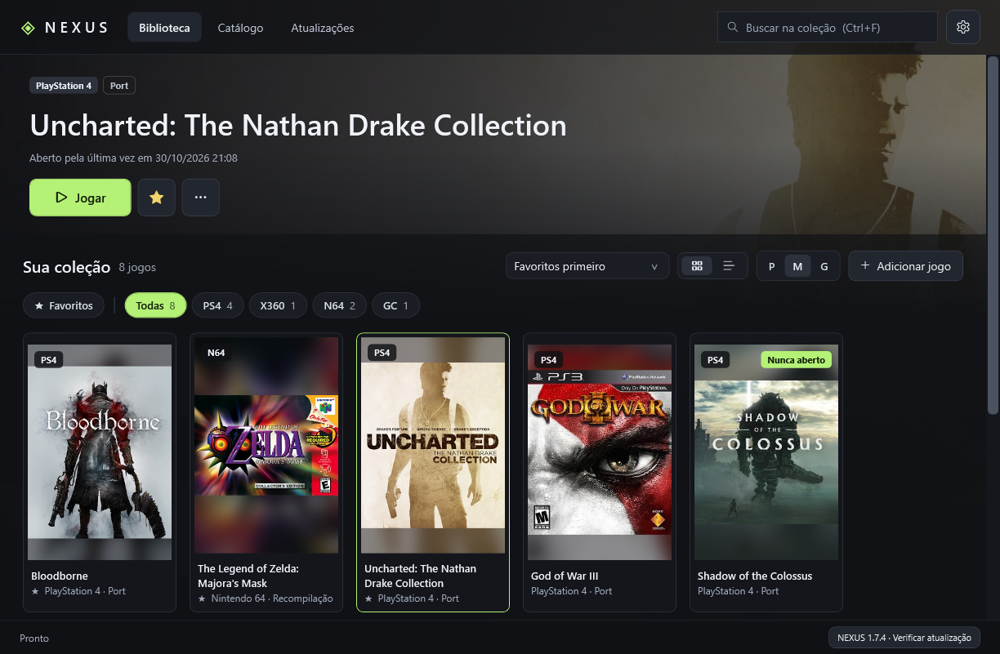
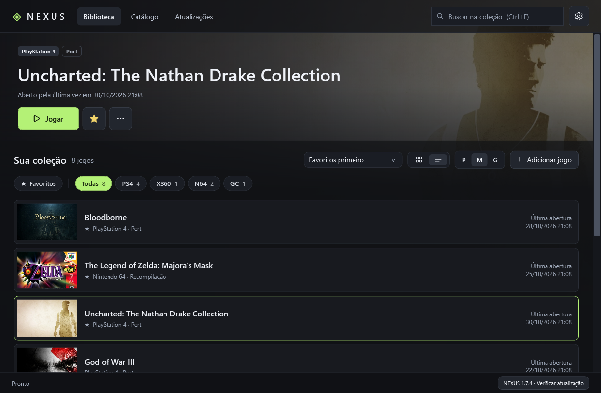

# NEXUS · Ports PC

**Sua biblioteca. Seu universo.**

Reúna seus ports de console em um só launcher para **Windows 11 x64**. Organize sua coleção, personalize as artworks, encontre os projetos por plataforma e abra seus jogos e configurações em um único lugar.

[**Baixar NEXUS**](https://github.com/teasergames/ports-pc/releases/latest) · [Releases e novidades](https://github.com/teasergames/ports-pc/releases) · [Catálogo de projetos](CATALOG.md) · [Relatar um problema](https://github.com/teasergames/ports-pc/issues/new/choose)

> [!NOTE]
> **Versão prévia 1.7.0-beta.1:** novo visual da biblioteca e do catálogo, filtros por tipo de projeto (port, recompilação, decompilação…) e modo de instalação, aba de novidades, catálogo atualizado online, atalhos de teclado e navegação por controle. Disponível nas [Releases](https://github.com/teasergames/ports-pc/releases) como pre-release; não é instalada pela atualização automática. As instruções abaixo descrevem a versão estável.

> [!IMPORTANT]
> **O NEXUS NÃO DISTRIBUI NENHUM TIPO DE ARQUIVO DOS JOGOS. VOCÊ PRECISARÁ DA SUA PRÓPRIA CÓPIA DUMPADA DO CONSOLE.**
>
> Nenhuma ROM, ISO, dump, chave de console ou firmware acompanha o NEXUS. Você precisa fornecer os arquivos da sua própria cópia do jogo, no formato e na versão exigidos por cada port. Baixar um port pelo catálogo não fornece o jogo.

*Exemplo ilustrativo da interface com uma biblioteca configurada. Os jogos e suas artworks não acompanham o download do NEXUS.*

## O que você pode fazer

- **Organizar sua coleção:** visualização em grade ou lista, tamanho ajustável, busca e favoritos.
- **Filtrar por plataforma:** PlayStation, Xbox, Nintendo e outras plataformas presentes no catálogo.
- **Baixar ports:** consultar os projetos e instalar os pacotes compatíveis a partir das fontes dos autores, quando houver integração disponível.
- **Jogar e configurar:** abrir o port e seu launcher de configuração conforme o suporte de cada projeto.
- **Personalizar o visual:** artworks locais ou busca online, com fundo do jogo selecionado.
- **Excluir um port:** conferir as pastas e confirmar a remoção permanente dos arquivos, incluindo backups e cache identificados quando selecionados.
- **Manter tudo atualizado:** verificar atualizações dos ports gerenciados e atualizar o próprio NEXUS, com reinício automático.

## Como instalar

1. Abra a página da [última versão](https://github.com/teasergames/ports-pc/releases/latest).
2. Em **Assets**, baixe o arquivo `Nexus-Ports-PC-v…-Windows-x64.zip`.
3. Extraia **todo o conteúdo** para uma pasta gravável de sua preferência. Não execute o aplicativo de dentro do ZIP.
4. Abra **`Nexus.exe`**, mantendo `Nexus.exe.config` e os demais arquivos ao lado dele. Preserve o nome `Nexus.exe` para as atualizações automáticas.

O NEXUS é portátil: não precisa de instalação tradicional, conta, Node.js ou Python para funcionar. O aplicativo utiliza o **.NET Framework 4.8**, disponível no Windows 11. O executável ainda não possui assinatura digital.

**Requisitos do launcher:** Windows 11 x64. Os requisitos dos jogos são próprios de cada port: confira a página do autor para CPU, placa de vídeo, drivers, espaço livre e versão do dump. A compatibilidade do NEXUS com o Windows não garante a execução de todos os jogos em qualquer PC.

## Como adicionar seus jogos

### Pelo catálogo

Abra **Baixar ports**, escolha a plataforma ou busque pelo título e leia as instruções do projeto. Use **Baixar e adicionar** ou **Baixar e instalar**, conforme o perfil, e escolha o destino.

Depois do download, prepare sua própria cópia do jogo no assistente do autor. Alguns projetos precisam compilar o jogo no primeiro início. Entradas com preparação manual abrem os downloads oficiais e explicam os passos necessários.

### Se você já tem um port instalado

Use **Adicionar jogo** e selecione o executável `.exe` ou atalho `.lnk`. Confira o nome, a plataforma e a pasta de trabalho; salve e clique em **Jogar**. **Detectar ports** procura instalações conhecidas na pasta Downloads.

Em **Editar cadastro**, você pode ajustar argumentos, escolher uma artwork e associar um launcher de configuração. **Configurar jogo** aparece quando existe uma configuração externa ou preparação compatível; alguns ports oferecem suas opções apenas dentro do jogo.

## Uma coleção do seu jeito

Alterne entre **Grade** e **Lista** e use o controle **Tamanho** para ajustar a visualização. O NEXUS lembra suas preferências.

As artworks podem ser escolhidas em **Editar cadastro → Escolher imagem**. A busca automática usa imagens locais, Wikipedia e, opcionalmente, sua chave do SteamGridDB. As opções ficam em **Configurações**.

## Atualizações

Ao abrir, o NEXUS verifica se há uma nova versão estável no GitHub. Quando disponível, baixa, verifica o pacote e reinicia automaticamente após atualizar. Também há um botão de verificação no rodapé e uma opção para desativar a atualização automática em **Configurações**.

Para os ports instalados pelo catálogo, use **Verificar atualizações** em **Baixar ports**. Quando houver uma versão compatível mais recente, o botão **Atualizar** ficará disponível. Feche o jogo antes de atualizar e siga as instruções do perfil; alguns projetos precisam repetir a preparação ou compilação.

As novidades e alterações de cada versão ficam exclusivamente nas [Releases](https://github.com/teasergames/ports-pc/releases).

## Como excluir um port

Selecione o jogo e clique em **Excluir port**. Confira as pastas, a quantidade de arquivos e o tamanho apresentados, marque a confirmação e use **Excluir port e arquivos**. A exclusão é permanente, sem Lixeira: dumps, saves e configurações que estiverem **dentro das pastas confirmadas** também serão apagados. Faça um backup antes de continuar.

Instalações gerenciadas usam sua pasta registrada. Para ports adicionados manualmente ou preparados por um assistente externo, escolha a pasta raiz dedicada ao port. Pastas protegidas, links e pastas compartilhadas com outro cadastro são bloqueados; feche o jogo e seu launcher antes de excluir. Arquivos em diretórios externos, como o dump de origem e saves em Documentos/AppData, permanecem no lugar. Para cadastros de atalhos `.lnk`, associe o executável real antes de excluir arquivos.

Se quiser apenas tirar o jogo da lista e manter a instalação, use **Editar cadastro → Remover da coleção**.

## Seus dados e backups

A biblioteca e as artworks ficam salvas localmente em `%LOCALAPPDATA%\NexusPortsPC`. Acesse **Configurações → Abrir dados locais** e copie essa pasta para fazer um backup. A biblioteca não é enviada ao GitHub.

Atualizações do NEXUS preservam a biblioteca, as artworks e os ports instalados. A busca de imagens pode ser desativada; ela envia o título do jogo aos serviços de imagem, sem enviar caminhos locais, saves ou executáveis.

## Ajuda e desenvolvimento

Encontrou um problema no launcher? [Abra uma issue](https://github.com/teasergames/ports-pc/issues) informando o que aconteceu e os passos para reproduzir. Para problemas específicos de um jogo, consulte também o repositório do autor do port.

Para compilar e testar o NEXUS, veja o [guia de desenvolvimento](docs/DEVELOPMENT.md). O código do launcher é distribuído sob a [licença MIT](LICENSE). Jogos, marcas e imagens pertencem aos seus respectivos titulares; os projetos de ports são independentes.
